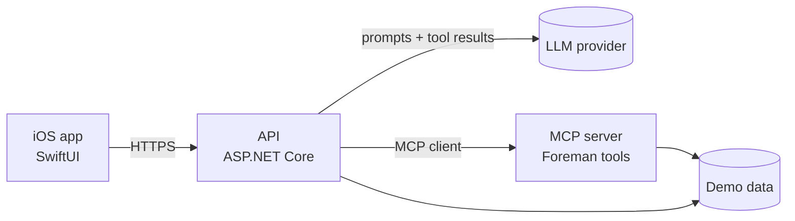

# Foreman Demo

> **Demonstration project.** This repository is a portfolio showcase. It uses fictional data, has no connection to any Blue Collar Workflows production system, and should not be used with real customer information.

Foreman is an AI assistant for small blue-collar service businesses. A job request comes in, Foreman drafts a quote using the business's price book, and the owner reviews and approves it before anything goes out. Foreman can draft; only a person can approve.

This repo shows the full path end to end:

- **iOS app (SwiftUI):** job intake, a chat with Foreman, and quote review/approval
- **API (C# / ASP.NET Core):** the system of record for customers, jobs and quotes, and the orchestrator for Foreman's model calls
- **MCP server:** the tools Foreman uses to look up customers, jobs and pricing, and to draft quotes
- **Docs:** architecture, decision records and setup guides

## Architecture

The approval gate lives in the API. The MCP server's write tools can only create drafts.

## Repository layout

| Folder | What's in it | Status |
| --- | --- | --- |
| [`ios/`](ios/) | SwiftUI app | Not started |
| [`api/`](api/) | ASP.NET Core API and Foreman orchestration | Not started |
| [`mcp-server/`](mcp-server/) | MCP server exposing Foreman's tools | Not started |
| [`docs/`](docs/) | Architecture notes and decision records ([`docs/adr/`](docs/adr/)) | In progress |

Each folder is a self-contained project with its own README, build and tests, so any piece can be built and run on its own.

## Getting started

Setup instructions will be added as each component lands. The goal is a single command to run the API and MCP server locally with seeded demo data, plus an Xcode project that points at it.

## Project tracking

Work is planned in epics: repo foundation, domain model, API, MCP server, Foreman assistant, iOS app, and showcase/docs.
