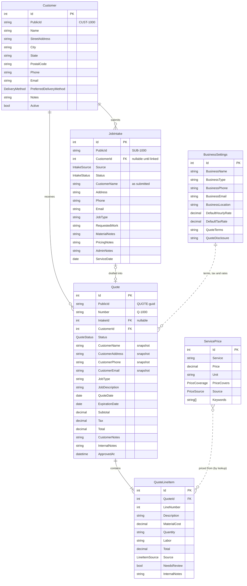
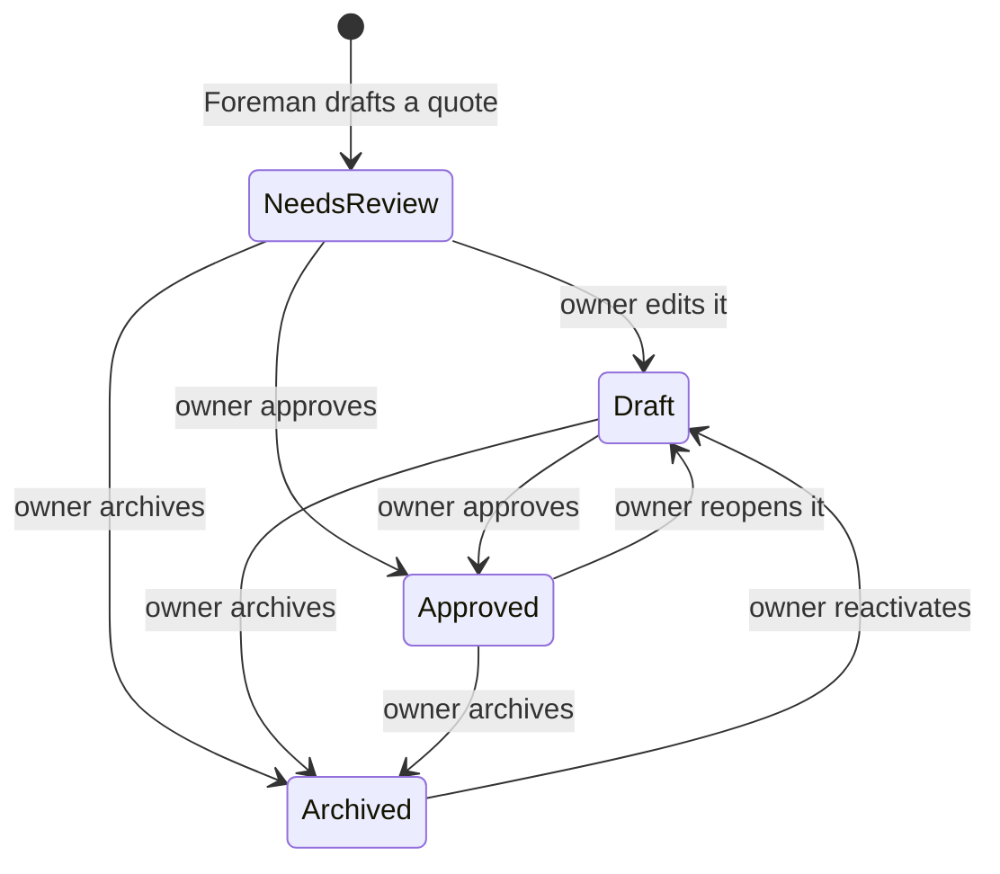
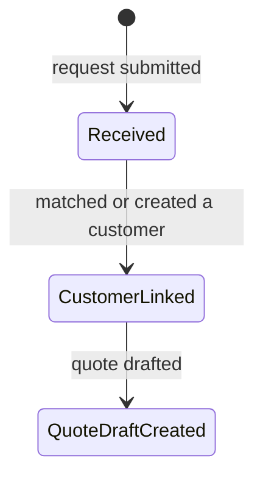

# Domain model

These are the business entities Foreman Demo works with. They mirror the quoting model in the Blue Collar Workflows platform, so the demo can be productionized later without renaming things. The entity names, fields, ID formats and quote lifecycle are the same.

The demo is narrower than the platform in three ways:

- **Single business.** The platform is multi-tenant, and every record belongs to one tenant. The demo holds one fictional business, so there's no tenant column. Adding one back is a schema change, not a redesign.
- **Quotes only.** The platform carries a quote through to invoices, payments and scheduling. The demo stops at an approved quote.
- **One price list.** The platform builds an owner's price list from a shared catalog of business types and service templates. The demo seeds the resulting price list directly.

## Diagram

Every entity also has `CreatedAt` and `UpdatedAt` (UTC). They're left out of the diagram to keep it readable.

## Entities

### Customer

The current profile for a customer of the business. Quotes copy the customer's contact details at the time they're issued, so editing a customer later never changes an existing quote.

| Field | Type | Notes |
| --- | --- | --- |
| `Id` | int | Database key. |
| `PublicId` | string | Human-readable ID, `CUST-` plus a number, for example `CUST-1000`. |
| `Name` | string, required | Up to 160 characters. |
| `StreetAddress`, `City`, `State`, `PostalCode` | string, optional | Address stored in parts. |
| `Phone` | string, optional | Normalized phone number. Intake matches existing customers by phone. |
| `Email` | string, optional | |
| `PreferredDeliveryMethod` | `DeliveryMethod` | `Email` when an email address is known, otherwise `Print`. |
| `Notes` | string, optional | |
| `Active` | bool | Defaults to `true`. Customers are deactivated, not deleted. |

### JobIntake

An incoming job request, before it becomes a quote. This is what the original ticket called "Job". The platform calls it a job intake because it's a request, not scheduled work.

| Field | Type | Notes |
| --- | --- | --- |
| `Id` | int | Database key. |
| `PublicId` | string | `SUB-` plus a number (a "submission"), for example `SUB-1000`. |
| `CustomerId` | int, optional | Empty until intake matches or creates a customer. |
| `Source` | `IntakeSource` | Where the request came from. |
| `Status` | `IntakeStatus` | Where the request is in processing. |
| `CustomerName`, `Address`, `Phone`, `Email` | string | Contact details exactly as submitted. Name is required. |
| `JobType` | string, optional | For example "Mulching" or "Lawn care". |
| `RequestedWork` | string, required | The customer's description of the work. This is Foreman's main input. |
| `MaterialNotes` | string, optional | Materials the customer mentioned. Carried to the quote as customer-facing notes. |
| `PricingNotes` | string, optional | Owner-facing pricing context. Carried to the quote as internal notes. |
| `AdminNotes` | string, optional | Owner-only notes. |
| `ServiceDate` | date, optional | Date the customer asked for. |

### Quote

A customer-facing estimate. A quote is created from an intake (at most one quote per intake) and keeps a snapshot of the customer's contact details at the time it was created.

| Field | Type | Notes |
| --- | --- | --- |
| `Id` | int | Database key. |
| `PublicId` | string | `QUOTE-` plus a GUID. Stable ID used in URLs and by Foreman's tools. |
| `Number` | string | Human-friendly number, `Q-` plus a sequence, for example `Q-1000`. Unique. |
| `IntakeId` | int, optional | The intake it came from. Unique when set. |
| `CustomerId` | int, required | |
| `Status` | `QuoteStatus` | See the lifecycle below. New quotes start in `NeedsReview`. |
| `CustomerName`, `CustomerAddress`, `CustomerPhone`, `CustomerEmail` | string | Snapshot taken when the quote is created. |
| `JobType` | string, optional | Copied from the intake. |
| `JobDescription` | string, optional | Starts as the intake's `RequestedWork`. |
| `QuoteDate` | date | Date the quote was created. |
| `ExpirationDate` | date, optional | Typically `QuoteDate` plus 30 days, matching the default quote terms. |
| `Subtotal` | decimal(12,2) | Sum of line item totals. Recalculated whenever lines are saved. |
| `Tax` | decimal(12,2) | `Subtotal` × `BusinessSettings.DefaultTaxRate`, or 0 when there's no tax rate. |
| `Total` | decimal(12,2) | `Subtotal` + `Tax`. |
| `CustomerNotes` | string, optional | Shown to the customer. |
| `InternalNotes` | string, optional | Owner-only. |
| `ApprovedAt` | datetime, optional | Set when the owner approves the quote. |

### QuoteLineItem

One priced piece of work on a quote. Lines are numbered 1, 2, 3 and so on within a quote, with no repeats. Saving a draft replaces the whole set of lines and recalculates the quote's totals.

| Field | Type | Notes |
| --- | --- | --- |
| `Id` | int | Database key. |
| `QuoteId` | int, required | Deleting a quote deletes its lines. |
| `LineNumber` | int | Position on the quote. Unique within the quote. |
| `Description` | string, required | Up to 255 characters. Blank lines are dropped when saving. |
| `MaterialCost` | decimal(12,2) | Defaults to 0. |
| `Quantity` | string, optional | Free text such as "3 cubic yards", because trades price in mixed units. |
| `Labor` | string, optional | Free text such as "4 hours". |
| `Total` | decimal(12,2) | Line total. |
| `Source` | `LineItemSource` | Who wrote the line. |
| `NeedsReview` | bool | Set by Foreman when it isn't confident in a line, for example when no price was found. The owner should check these lines before approving. |
| `InternalNotes` | string, optional | Owner-only notes, such as how Foreman arrived at the price. |

### ServicePrice

One entry in the business's price list, which Foreman uses to price line items. This is what the original ticket called "PriceBookItem". The tool and API names can keep saying "price book".

| Field | Type | Notes |
| --- | --- | --- |
| `Id` | int | Database key. |
| `Service` | string, required | Service name, for example "Mulch installation". Unique. |
| `Price` | decimal(12,2) | |
| `Unit` | string | For example "per sq ft", "per cubic yard", "per hour" or "flat rate". |
| `PriceCovers` | `PriceCoverage` | What the price includes. |
| `Source` | `PriceSource` | Where the price came from. |
| `Keywords` | string list | Words used to match a job's requested work to this service, for example "mulch", "beds". |

### BusinessSettings

A single row with the business's profile and quoting defaults. Foreman reads these values, and only the owner changes them.

| Field | Type | Notes |
| --- | --- | --- |
| `BusinessName`, `BusinessType` | string | `BusinessType` tailors Foreman's questions and wording, for example "Landscaping". |
| `BusinessPhone`, `BusinessEmail`, `BusinessLocation` | string | Shown on quotes. |
| `DefaultHourlyRate` | decimal, optional | Used for labor when a service has no price of its own. |
| `DefaultTaxRate` | decimal, optional | Stored as a fraction (`0.07` means 7%). Empty means no tax. |
| `QuoteTerms` | string | Defaults to "Quote valid for 30 days unless otherwise noted." |
| `QuoteDisclosure` | string, optional | Exclusions and limits, for example hidden damage or permits. |

## Value types

| Enum | Values | Notes |
| --- | --- | --- |
| `QuoteStatus` | `NeedsReview`, `Draft`, `Approved`, `Archived` | See the lifecycle below. |
| `IntakeStatus` | `Received`, `CustomerLinked`, `QuoteDraftCreated` | |
| `IntakeSource` | `Web`, `Staff`, `Foreman` | |
| `LineItemSource` | `Foreman`, `Owner`, `TradeProfile` | `TradeProfile` lines come from standard scope rules for the business type. |
| `PriceCoverage` | `Included`, `LaborOnly`, `MaterialOnly` | `Included` means labor and materials. |
| `PriceSource` | `Onboarding`, `OwnerDefined` | |
| `DeliveryMethod` | `Email`, `Print` | |

## Quote lifecycle

Rules:

1. **Foreman can only draft.** Foreman's `draft_quote` tool creates quotes in `NeedsReview` and can edit lines only while a quote is in `NeedsReview` or `Draft`. Foreman has no way to approve, reopen or archive.
2. **Only the owner approves.** The only path to `Approved` is the API's approval endpoint, which requires an owner action (BCW-19). Approving sets `ApprovedAt`.
3. **Approved quotes are locked.** Lines and totals can't change while a quote is `Approved`. To change one, the owner reopens it, which moves it back to `Draft` and clears `ApprovedAt`.
4. **Archive instead of delete.** Archiving hides a quote from the active list without losing it. Reactivating an archived quote returns it to `Draft`.
5. **Approving twice is harmless.** Approving a quote that's already approved does nothing and doesn't return an error.

The platform also has `Sent`, `Scheduled` and `ConvertedToInvoice`, for customer review links, scheduling and invoicing. The demo leaves those features out, so it leaves those statuses out too.

## Intake lifecycle

Intake matches an existing customer by normalized phone number. If there's no match, it creates a new customer, using `Email` as the delivery method when an email address was given and `Print` when it wasn't.

## Left out on purpose

These platform features aren't in the demo:

| Platform feature | Why it's left out |
| --- | --- |
| Tenants, users, memberships and billing | The demo is one fictional business. Demo sign-in is BCW-22. |
| Invoices, invoice lines and payments | The demo stops at an approved quote. |
| Customer review links (`Sent` status, review tokens) | Quotes aren't sent to customers in the demo. |
| Scheduling | Not part of the quote flow being demonstrated. |
| Intake attachments | Photo upload isn't in the demo scope. It could be added later. |
| Business types, service templates and pricing questions | The demo seeds the resulting price list directly. |
| Document number sequences and error logs | Implementation details for BCW-14, not domain entities. |
